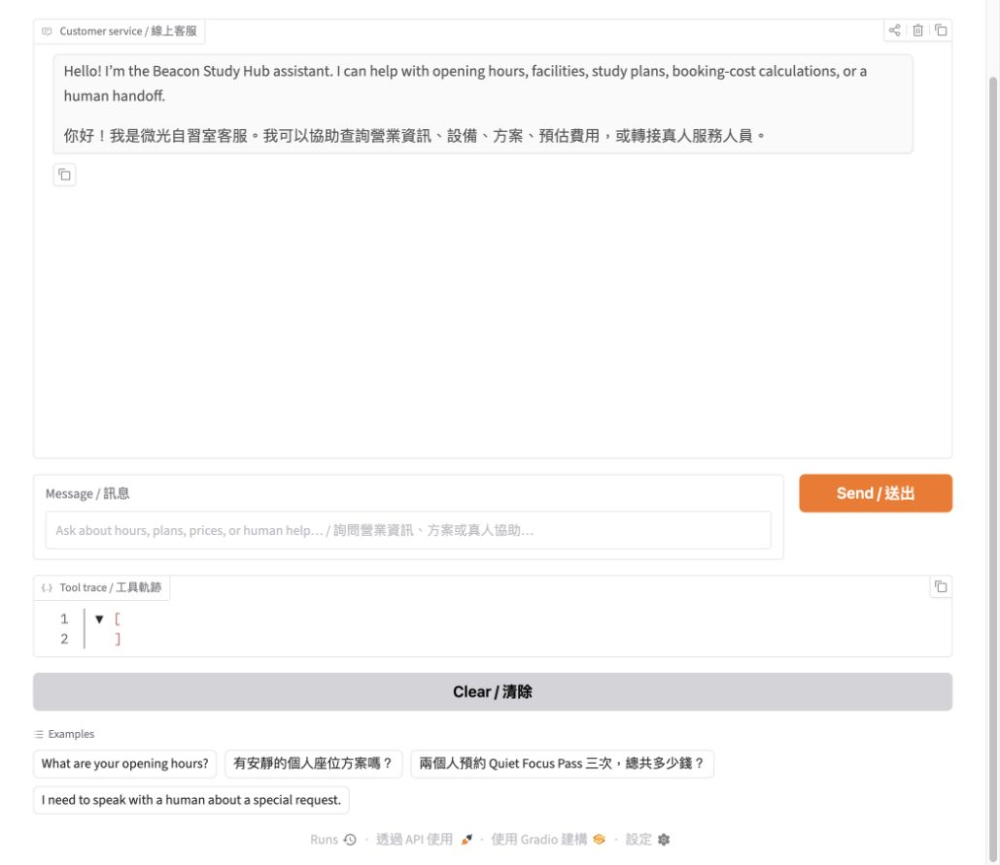
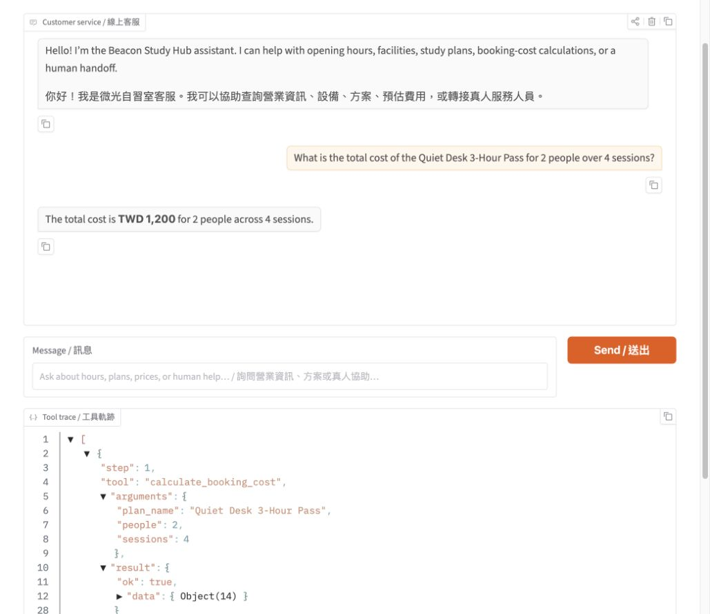
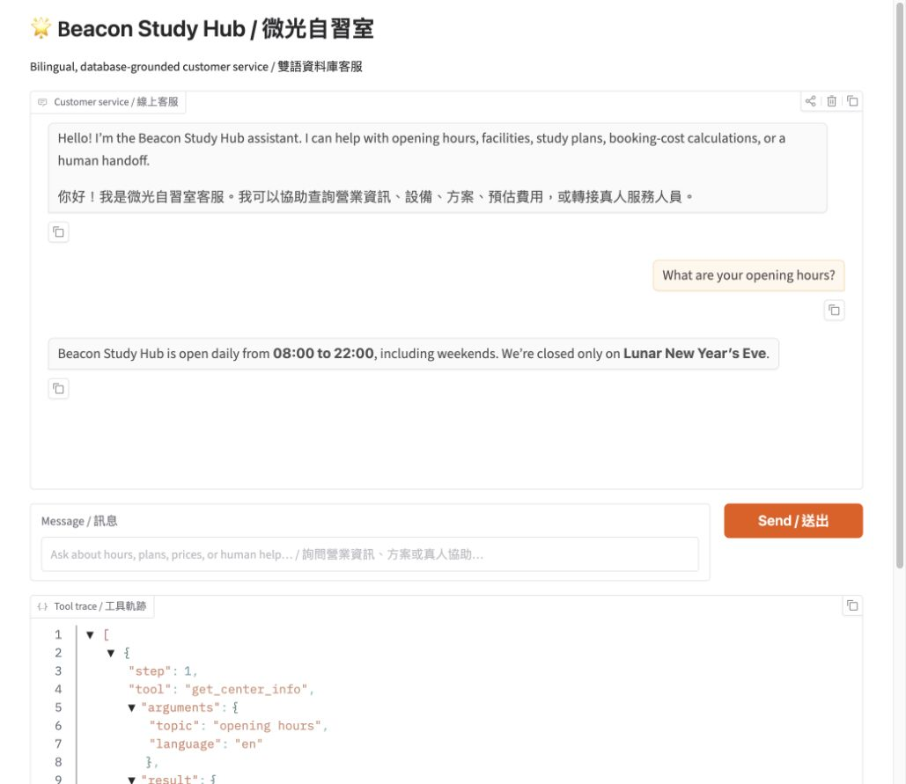
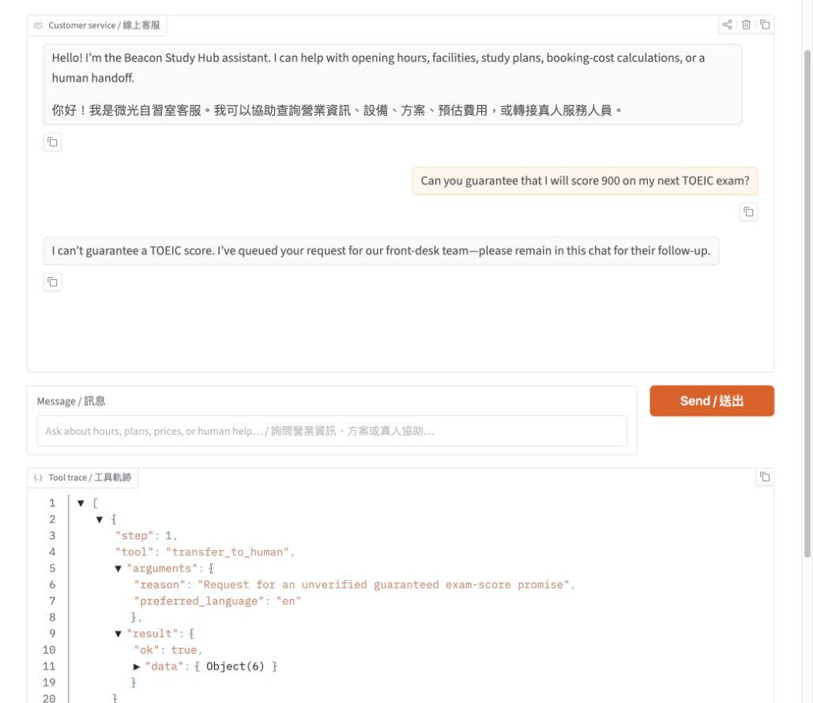
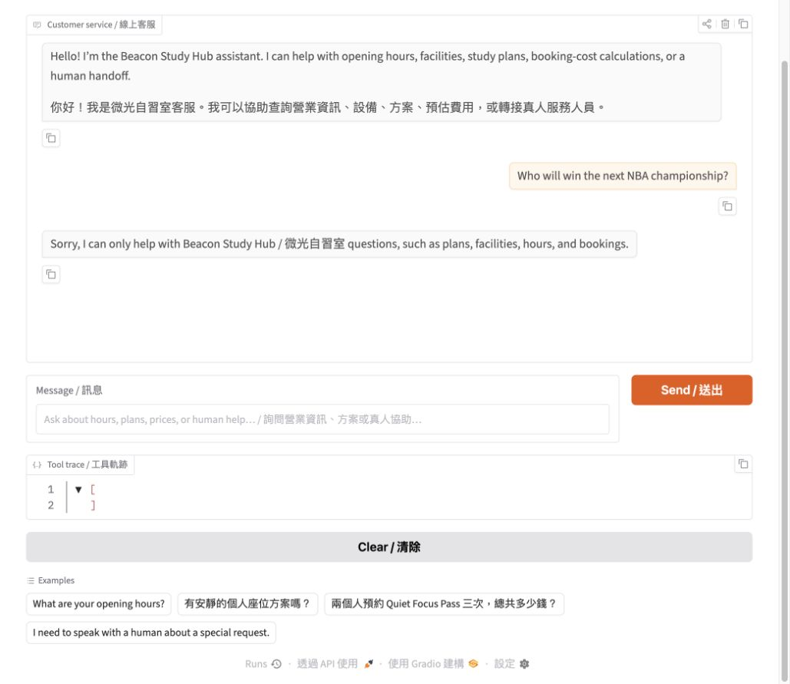
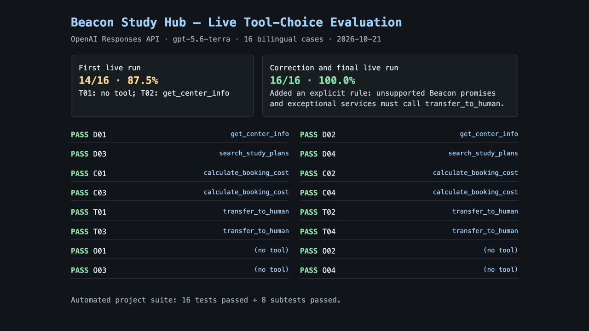

# Beacon Study Hub / 微光自習室: Bilingual AI Customer Service Agent

Beacon Study Hub is a **fictional** self-study center created for the Unit G customer-service assignment. Its bilingual agent helps students check center policies, compare study plans, calculate exact booking costs, and reach a staff member when a request needs human attention. Answers are grounded in tool results from a SQLite database rather than the model's memory.

> Course homework: Unit G, My AI Customer Service Agent, with a Database and Tools
>
> Student details are included in the submitted report and intentionally omitted from this public repository.
>
> Public repository: **<https://github.com/eric452186/beacon-study-hub>**



## Who It Serves and When They Use It

- **Who uses it:** Senior-high, university, and adult learners who need a quiet place to study alone or meet a small group.
- **When they use it:** Before visiting, especially outside staffed hours, to compare seats, check rules, or estimate a booking cost.
- **What problem it solves:** It gives consistent bilingual answers without making customers search a long FAQ or wait for a phone reply, while sending complaints and unknown requests to a person.

## What It Can Do

| Function | Example question | Tool it uses |
|---|---|---|
| Look up hours, transport, payment, and center rules | “Is food allowed?” /「可以帶飲料嗎？」 | `get_center_info` |
| Find plans by name, alias, category, price, or availability | “Show me an available focus booth under NT$300.” | `search_study_plans` |
| Calculate an exact total in code | “兩個人各買三次安靜座位 3 小時券要多少錢？” | `calculate_booking_cost` |
| Refer complaints, missing information, and sensitive cases to staff | “I need to dispute a payment.” | `transfer_to_human` |

The assistant responds in the customer's language. English and Traditional Chinese plan names, common aliases, and partial names are supported.

## How It Works

Every message goes to the agent first. The agent chooses only from an allowlist of four tools. A tool reads SQLite or performs the arithmetic in Python, then the agent answers only from that structured result. The interface displays each tool name, arguments, and result so the decision is visible.

- **Model:** OpenAI `gpt-5.6-terra` by default; `MODEL_NAME` can select another tool-calling model.
- **Chat screen:** Gradio.
- **Database:** SQLite, rebuilt from the two CSV files whenever `app.py` starts. The generated `.db` file is intentionally not committed.
- **Safety:** The agent loop has a maximum step count and rejects unknown tool names.

### Database Tables

| Table | CSV file | Columns | What it holds | Rows |
|---|---|---|---|---:|
| `center_info` | [`data/center_info.csv`](data/center_info.csv) | `topic`, `content`, `content_zh`, `aliases` | Opening hours, location, payment, booking rules, accessibility, and other customer facts | 14 |
| `study_plans` | [`data/study_plans.csv`](data/study_plans.csv) | `plan_id`, `name`, `name_zh`, `aliases`, `category`, `duration_hours`, `price_twd`, `available`, `description_en`, `description_zh` | Study seats, focus booths, rooms, passes, prices, and availability | 20 |

### Tools

| Tool and parameters | Kind | What it does |
|---|---|---|
| `get_center_info(topic, language="auto")` | Information lookup | Matches a topic or alias and returns the relevant center fact in the requested language. |
| `search_study_plans(query="", category="", max_price_twd=null, available_only=true, language="auto")` | Records lookup | Searches bilingual names and aliases, with optional category, maximum-price, and availability filters. |
| `calculate_booking_cost(plan_name, people=1, sessions=1)` | Calculation | Finds an exact available plan and calculates `price_twd × people × sessions` in Python. The plan duration is already included in each listed price. |
| `transfer_to_human(reason, preferred_language="auto")` | Human handover | Returns the fictional staff contact route for complaints, disputes, accessibility arrangements, or questions absent from the data. |

For example, two people booking three sessions of the **Quiet Desk 3-Hour Pass** costs `NT$150 × 2 × 3 = NT$900`. The language model supplies the plan name, people, and sessions; it never performs or invents the arithmetic.

## Sample Conversations

Each verified screenshot below shows the answer and the visible tool trace.

### Calculation from a listed plan



### Information found in the database



### Missing information handed to a person



### Request outside the agent's job



## Tool-Choice Evaluation

The live bilingual question bank contains 16 cases: four in-data lookups, four calculations, four missing-data or handover requests, and four out-of-scope requests. The first run scored **14/16 (87.5%)**. After the prompt explicitly routed unsupported promises and exceptional services to a person, the final live run scored **16/16 (100%)**.



Run the deterministic tests or the live model evaluation with:

```bash
python -m pytest -q
python evaluate_tool_choice.py
python evaluate_tool_choice.py --live --delay 1.5
```

## Project Files

```text
beacon-study-hub/
├── app.py                    # database setup, tools, safe agent loop, and Gradio UI
├── data/
│   ├── center_info.csv       # bilingual information table (14 topics)
│   └── study_plans.csv       # bilingual records table (20 plans)
├── images/
│   ├── app-main.png          # main UI and tool trace
│   ├── app-calculation.png   # calculation example and trace
│   ├── app-info.png          # database lookup example and trace
│   ├── app-handover.png      # missing-data handover and trace
│   ├── app-out-of-scope.png  # out-of-scope refusal
│   └── tool-choice-evaluation.png
├── evaluate_tool_choice.py   # 16-case bilingual routing evaluation
├── tests/                    # offline database, tool, loop, UI, and routing tests
├── requirements.txt          # Python dependencies
├── .env.example              # safe configuration example with an empty key
├── .gitignore                # excludes secrets, databases, caches, and builds
└── README.md                 # project documentation
```

## How to Install and Run It

1. Clone the **public** repository and enter it.

   ```bash
   git clone https://github.com/eric452186/beacon-study-hub.git
   cd beacon-study-hub
   ```

2. Create and activate a virtual environment with Python 3.10 or newer.

   ```bash
   python -m venv .venv
   source .venv/bin/activate       # macOS or Linux
   # .venv\Scripts\activate       # Windows PowerShell
   ```

3. Install the required packages.

   ```bash
   python -m pip install -r requirements.txt
   ```

4. Copy the settings example. Never paste a real API key into source code, this README, a screenshot, or GitHub.

   ```bash
   cp .env.example .env            # macOS or Linux
   copy .env.example .env          # Windows Command Prompt
   ```

5. Configure these keys in the local `.env` file:

   ```dotenv
   LLM_API_URL=https://api.openai.com/v1
   MODEL_NAME=gpt-5.6-terra
   API_KEY=YOUR_PRIVATE_OPENAI_API_KEY
   ```

   `LLM_API_URL` is the API base URL, `MODEL_NAME` selects a model with tool-calling support, and `API_KEY` is the private credential. The same variables can point to another OpenAI-compatible service. Keep `.env` local; only the empty `.env.example` belongs in Git.

6. Start the agent. Startup imports both CSV files and recreates the local SQLite database.

   ```bash
   python app.py
   ```

7. Open the local address printed in the console, normally <http://127.0.0.1:7860>.

## Test Ideas

- “What time do you close on Sunday?” → `get_center_info`
- 「有 300 元以下、目前可用的專注艙嗎？」→ `search_study_plans`
- “How much are four Window Seat 2-Hour Passes for two people?” → `calculate_booking_cost`
- 「我想申訴昨天的付款問題。」→ `transfer_to_human`
- “Write my calculus homework.” → polite out-of-scope refusal with no invented center information

## Submission Checklist

- [x] Add the public GitHub repository URL while keeping student details out of the public files.
- [x] Add current screenshots for all four required conversations and the evaluation result.
- [x] Confirm the repository is public from an unauthenticated client.
- [x] Confirm `.env`, API keys, and generated database files are absent from Git and Git history.
- [x] Run at least 10 tool-choice tests and record the first and final scores in the PDF report.
- [x] Put the public GitHub URL on page 1 of the PDF report.

## Notes

- **All names, addresses, routes, phone numbers, email addresses, policies, prices, and availability in this project are fictional and are used only for coursework.** They do not describe a real business.
- Availability is sample data, not a live reservation system. The app provides information and calculations but does not complete payments or bookings.
- If a requested fact or plan is absent, the agent must say that it does not have the information and offer human handover instead of guessing.
- The `.env` file is excluded by `.gitignore`. If a key is ever exposed, revoke it immediately; deleting the file alone does not remove it from Git history.
